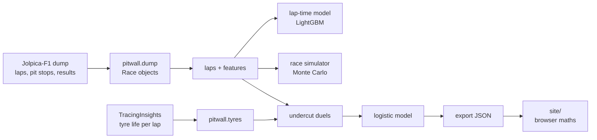

# pitwall

Formula 1 race-strategy models built only from public lap data: a lap-time forecaster, an undercut probability tool,
and a race simulator. Each of the three models was tested on 2026 races that stayed locked until the end.

**Live:** <https://shlokkvaishnav.github.io/pitwall/>: the undercut tool runs in your browser, next to a lap-by-lap replay
of the lap-time forecast on a 2026 race that was not in its training data.

[](https://shlokkvaishnav.github.io/pitwall/)

## What it does
- **Lap-time model.** LightGBM predicts each car's next lap time from its recent laps, tyre age, gaps to the cars around it
  and track evolution. It learns a correction to "next lap = last lap", and it is pre-trained on 2022 to 2025 before the new 2026 cars.
  Each forecast comes with a range (split conformal intervals, calibrated on the earlier 2026 races).
- **Undercut tool.** You are close behind a rival and pit first for fresh tyres. A logistic regression gives the chance that you
  come out ahead, from three numbers a strategist knows at that moment: the gap, the tyre-age difference and the laps left.
  It learned from 1,190 real pit duels (2018 to 2026). The site shows the probability, a map over gap and tyre age, and what moves it.
- **Race simulator.** A Monte Carlo model plays each race 2,000 times and gives finishing-position probabilities.

## What works and what does not
The 2026 races from 1 September were locked in code until the end. The final models ran on them once
(6 races, [spec 11](docs/specs/11-holdout.md)).

| Part | Development (2018 to Aug 2026) | Locked races (Sep to Oct 2026) |
|---|---|---|
| Lap-time model | 11.5% lower error than "next lap = last lap" | **Holds up.** 17% lower error (0.78 s vs 0.94 s), better in all 6 races, 5,354 laps. |
| Lap-time ranges | The 80% range holds 78.3% of laps. The 95% range holds 92.8%: slightly too narrow, so [spec 12](docs/specs/12-lap-intervals.md) fails. | Not tested. Added after the locked test; [spec 13](docs/specs/13-out-of-sample-rounds.md) tests it on rounds 19 to 23. |
| Undercut tool | Brier skill 0.22 on 2024 and 2025 | **Not confirmed.** Only 20 undercut attempts in these races, and the model did no better than the base rate. Too few to judge: if the model is as good as on 2024 and 2025, about 80 are needed for 80% power. |
| Race simulator | Does not beat the starting grid | Orders the field better than the grid, but its podium odds are worse. |
| Battery use from lap times | Not visible: lap times are too coarse | Not tested. Code archived (tag `energy-experiment`). |

The undercut probability is learned from attempts that teams chose to make, so it is not advice on whether to pit.
**How it was tested, every experiment, and the known limitations: [docs/method.md](docs/method.md).**

## Architecture


## Engineering
- **One-command rebuild.** `make reproduce` downloads the public data (the dump has a pinned SHA-256), runs every experiment,
  and compares every number with the committed results. `make docker-reproduce` does the same in a clean container.
  The last Docker run (before specs 12 and 13) rebuilt all 11 result files of that time with no difference.
- **The browser and Python agree.** A Node test checks that the JavaScript model gives the scikit-learn probabilities (difference < 1e-5).
- **Checks on each push:** ruff (lint), mypy (types), pytest, Node tests. CI runs only on push, never on a schedule.
- **No raw data in the repository.** The site shows only model numbers.

## Quick start
```bash
make install        # Python 3.12, creates .venv (pinned versions: requirements.lock)
make check          # lint, types, tests
make reproduce      # download the data and rebuild all results (about 30 minutes)
```

## Layout
| Path | Content |
|---|---|
| `src/pitwall/` | Data loaders, lap features, models, simulator, undercut duels |
| `scripts/` | One script per experiment, plus the data download and the site export |
| `docs/method.md` | How it was tested, all results, known limitations |
| `docs/specs/` | The written plan and result of each experiment |
| `results/` | The result of each experiment (JSON, with the git commit) |
| `site/` | The web page (HTML, CSS, JavaScript, no framework) |

## Data and credits
- [Jolpica-F1](https://github.com/jolpica/jolpica-f1) database dump (non-commercial use).
- [TracingInsights](https://github.com/TracingInsights) open data, MIT and Apache-2.0.
- Related work: a July 2026 preprint with a similar undercut model, [arXiv 2607.06495](https://arxiv.org/abs/2607.06495).
  [Spec 10](docs/specs/10-undercut-open-events.md) compares the two models directly.
- Fonts: Literata and Instrument Sans (SIL Open Font License), in `site/assets/licenses/`.
