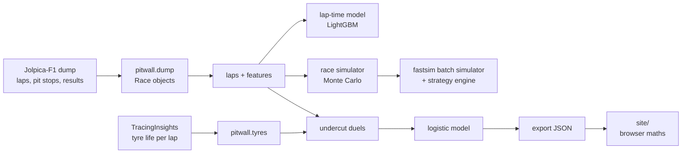

# pitwall

A Formula 1 strategy engine. It combines lap-time, safety-car and overtaking prediction models with Monte Carlo
simulation to forecast race outcomes and to evaluate pit-stop strategies, using public lap data only.

**Problem.** A team's strategy model decides when to pit and how a race is likely to finish. pitwall asks how far public
data can take you towards such a model, builds it one layer at a time, and tests each layer on races it has not seen,
including the places where it fails.

**Live demo:** <https://shlokkvaishnav.github.io/pitwall/>. The site runs in your browser: a lap-by-lap replay of the
lap-time forecast, one race seen through every layer, and the undercut tool.

[](https://shlokkvaishnav.github.io/pitwall/)

## Capabilities
- Forecast each car's next lap time, with prediction ranges.
- Estimate when a safety car or VSC is likely, and when a car can overtake.
- Simulate the rest of a race many times to forecast finishing positions and compare pit-lap choices.
- Recompute all of this lap by lap on a replayed race (see Engineering for the measured speed).

[](https://shlokkvaishnav.github.io/pitwall/)

## The layers
| Layer | Question | Model |
|---|---|---|
| Pace | How fast will each car go next lap, and how sure are we? | LightGBM on recent laps, tyre age, gaps and track evolution, pre-trained on 2022 to 2025; conformal ranges; a causal transformer over each car's laps as a challenger |
| Race events | When does a safety car or VSC come out? | Official race-control laps (OpenF1); a per-lap hazard with lap-1 and circuit terms, circuits shrunk to the mean |
| Racing | When can a car pass, and when does an undercut work? | LightGBM on pairs of cars one lap at a time; a logistic undercut model from 1,190 real pit duels (2018 to 2026) |
| Strategy | Put together, how does the race finish? | Monte Carlo simulators: B (pace, tyres, stops), C (B plus the hazard, passing and teams pitting under a safety car) and D (C with tuned settings), none better than the starting grid; an engine that re-simulates the rest of a race to rank pit laps (no better than a fixed-lap rule against real stops) |

## Verified results and limitations
Development numbers are walk-forward on earlier races. "Locked" means races kept out of everything until one final run:
2026 rounds 13 to 18 were used up by [spec 11](docs/specs/11-holdout.md); rounds 19 to 23 are the next test
([spec 13](docs/specs/13-out-of-sample-rounds.md)), run once after the season ends on 6 December 2026.

| Layer | Part | Development | Locked races |
|---|---|---|---|
| Pace | Lap-time model | 11.5% lower error than "next lap = last lap" | **Holds up** (rounds 13 to 18): 17% lower error (0.78 s vs 0.94 s), better in all 6 races, 5,354 laps. |
| Pace | Lap-time ranges | The 80% range holds 78.3% of laps; the 95% range holds 92.8%, slightly too narrow, so [spec 12](docs/specs/12-lap-intervals.md) fails. | Rounds 19 to 23. |
| Pace | Transformer lap model ([spec 17](docs/specs/17-deep-lap-model.md)) | On 2026 rounds 4 to 12: mean error 0.93 s against 1.03 s for the LightGBM model (95% interval of the gap −0.15 to −0.05 s), better in 7 of 9 races. | Rounds 19 to 23. |
| Race events | Neutral laps from lap times | Against official race control (80 races, [spec 14](docs/specs/14-official-flag-laps.md)) it finds 96% of safety-car laps but only 40% of VSC laps. Official laps cut the lap-time error on rounds 4 to 12 from 1.03 s to 0.78 s (exploratory). | — |
| Race events | Safety-car hazard ([spec 15](docs/specs/15-sc-hazard.md)) | Per-lap log loss 0.0969, against 0.1030 for one constant rate and 0.1140 for the old simulator's circuit average. | Rounds 19 to 23. |
| Racing | Overtaking model ([spec 16](docs/specs/16-overtaking.md)) | Log loss 0.154 on 2026 rounds 1 to 12, against 0.249 for the simulator's pace-only rule and 0.257 for the base rate. | Rounds 19 to 23. |
| Racing | Undercut tool | Brier skill 0.22 on 2024 and 2025. | **Not confirmed** (rounds 13 to 18): only 20 attempts, no better than the base rate. Too few to judge: about 80 are needed for 80% power. |
| Strategy | Simulator B | Does not beat the starting grid. | Orders the field better than the grid, but its podium odds are worse. |
| Strategy | Simulator C ([spec 20](docs/specs/20-simulator-c.md)) | Almost the same as B (podium Brier 0.0780 vs 0.0785) and still worse than the grid (0.070). The new layers are better on their own but do not move the whole: the pace input limits it. | Rounds 19 to 23. |
| Strategy | Simulator D ([spec 21](docs/specs/21-simulator-d.md)) | Podium Brier 0.0701 with its two settings tuned on rounds 4 to 12, level with the grid (0.0700); 0.0748 when the setting is chosen without the scored race. Spearman 0.791 against 0.785 for the grid. | Rounds 19 to 23 (registered, runs once). |
| Strategy | Engine pit window against real teams ([spec 22](docs/specs/22-decision-check.md)) | From the real race at the start of each stint, the 7-lap window holds the top 5 finishers' real stop in 29% of 591 stops (2023 to 2025; 95% interval 24 to 35%), below a fixed-lap rule (37%). The simulator has one wear rate for all compounds, so it does not reproduce teams' tyre plans. With wear per compound fitted on 2019 to 2022 ([spec 23](docs/specs/23-compound-wear.md)) it drops to 27%: lap times alone do not separate the compounds well. SIMULATED check ([spec 24](docs/specs/24-simulated-regret.md); scored by the engine's own model, so not independent evidence): its laps cost 2.3 s less simulated race time than the teams' real laps (95% interval 1.4 to 3.4 s) and the same as the fixed-lap rule (-0.04 s, -0.7 to 0.6). | Rounds 19 to 23 (registered). |
| — | Battery use from lap times | Not visible: lap times are too coarse. Code removed. | — |

The undercut probability is learned from attempts that teams chose to make, so it is not advice on whether to pit.
**How it was tested, every experiment, and the known limitations: [docs/method.md](docs/method.md).**

## Architecture


## Secondary components
The undercut-probability model (specs 7 to 10) and the reinforcement-learning pit agent (spec 18, `scripts/rl_strategy.py`,
`pitwall.strategy_env`) are kept in the repository but are not part of the main engine. The undercut model was not
confirmed on the locked races (see above). The RL code is exploratory: there is no committed result file for it, and no claim here rests on it.

## Engineering
- **One-command rebuild.** `make reproduce` downloads the public data (the dump has a pinned SHA-256), runs every experiment,
  and compares every number with the committed results. `make docker-reproduce` does the same in a clean container.
  The last Docker run (before specs 12 and 13) rebuilt all 11 result files of that time with no difference.
- **Fast Monte Carlo core.** `pitwall.fastsim` runs all simulated races of a batch in one set of numpy arrays, with a
  memo over the cells of the passing model's trees (same values as the trees). On the same three race inputs it runs
  530 to 1,490 races a second against 4 to 7 for the one-race-at-a-time simulator C, about 200 times faster
  (`results/bench-sim.json`: three 2026 races, measured on a laptop under other load, so treat the factor as rough). A test checks that both give the same distribution of
  finishing positions.
- **Live replay.** `scripts/replay.py` feeds a past race to the engine one lap at a time, using only the laps run so
  far: each lap it re-simulates the rest of the race (500 races for the finishing order, up to 600 for the pit window)
  and recomputes the undercut chance. Median update 0.52 s, 95th percentile 1.05 s, measured on one race (the 2026 Dutch GP) and one car (`results/replay.json`).
- **The browser and Python agree.** A Node test checks that the JavaScript model gives the scikit-learn probabilities (difference < 1e-5).
- **Checks on each push:** ruff (lint), mypy (types), pytest, Node tests. CI runs only on push, never on a schedule.
- **No raw data in the repository.** The site shows only model numbers.

## Quick start
```bash
make install        # Python 3.12, creates .venv (pinned versions: requirements.lock)
make check          # lint, types, tests
make reproduce      # download the data and rebuild all results (about 30 minutes)
```

## Layout
| Path | Content |
|---|---|
| `src/pitwall/` | Data loaders, lap features, models, simulator, undercut duels |
| `scripts/` | One script per experiment, plus the data download and the site export |
| `docs/method.md` | How it was tested, all results, known limitations |
| `docs/specs/` | The written plan and result of each experiment |
| `results/` | The result of each experiment (JSON, with the git commit) |
| `site/` | The web page (HTML, CSS, JavaScript, no framework) |

## Data and credits
- [Jolpica-F1](https://github.com/jolpica/jolpica-f1) database dump (non-commercial use).
- [TracingInsights](https://github.com/TracingInsights) open data, MIT and Apache-2.0.
- [OpenF1](https://openf1.org) race control messages (2023 on), for the official safety-car, VSC and red-flag laps.
- Related work: a July 2026 preprint with a similar undercut model, [arXiv 2607.06495](https://arxiv.org/abs/2607.06495).
  [Spec 10](docs/specs/10-undercut-open-events.md) compares the two models directly.
- Fonts: Literata and Instrument Sans (SIL Open Font License), in `site/assets/licenses/`.
