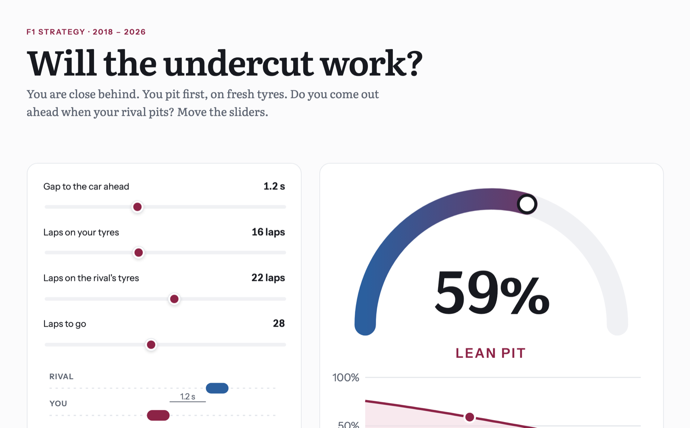
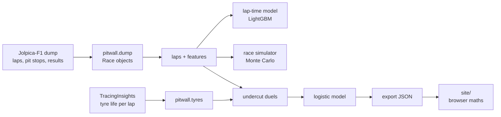

# pitwall

**How far can public lap data take you towards a team's race-strategy model, and where does it break?** pitwall builds
that model one layer at a time, from public lap data only, and tests each layer on races it has not seen.

**Live:** <https://shlokkvaishnav.github.io/pitwall/>: the undercut tool runs in your browser, next to a lap-by-lap replay
of the lap-time forecast and one race seen through every layer.

[](https://shlokkvaishnav.github.io/pitwall/)

## The layers
| Layer | Question | Model |
|---|---|---|
| Pace | How fast will each car go next lap, and how sure are we? | LightGBM on recent laps, tyre age, gaps and track evolution, pre-trained on 2022 to 2025; conformal ranges; a causal transformer over each car's laps as a challenger |
| Race events | When does a safety car or VSC come out? | Official race-control laps (OpenF1); a per-lap hazard with lap-1 and circuit terms, circuits shrunk to the mean |
| Racing | When can a car pass, and when does an undercut work? | LightGBM on pairs of cars one lap at a time; a logistic undercut model from 1,190 real pit duels (2018 to 2026) |
| Strategy | Put together, how does the race finish? | Monte Carlo simulators: B (pace, tyres, stops) and C (B plus the hazard, passing and teams pitting under a safety car) |

## Scorecard
Development numbers are walk-forward on earlier races. "Locked" means races kept out of everything until one final run:
2026 rounds 13 to 18 were used up by [spec 11](docs/specs/11-holdout.md); rounds 19 to 23 are the next test
([spec 13](docs/specs/13-out-of-sample-rounds.md)), run once after the season ends on 6 December 2026.

| Layer | Part | Development | Locked races |
|---|---|---|---|
| Pace | Lap-time model | 11.5% lower error than "next lap = last lap" | **Holds up** (rounds 13 to 18): 17% lower error (0.78 s vs 0.94 s), better in all 6 races, 5,354 laps. |
| Pace | Lap-time ranges | The 80% range holds 78.3% of laps; the 95% range holds 92.8%, slightly too narrow, so [spec 12](docs/specs/12-lap-intervals.md) fails. | Rounds 19 to 23. |
| Pace | Transformer lap model ([spec 17](docs/specs/17-deep-lap-model.md)) | On 2026 rounds 4 to 12: mean error 0.93 s against 1.03 s for the LightGBM model (95% interval of the gap −0.15 to −0.05 s), better in 7 of 9 races. | Rounds 19 to 23. |
| Race events | Neutral laps from lap times | Against official race control (80 races, [spec 14](docs/specs/14-official-flag-laps.md)) it finds 96% of safety-car laps but only 40% of VSC laps. Official laps cut the lap-time error on rounds 4 to 12 from 1.03 s to 0.78 s (exploratory). | — |
| Race events | Safety-car hazard ([spec 15](docs/specs/15-sc-hazard.md)) | Per-lap log loss 0.0969, against 0.1030 for one constant rate and 0.1140 for the old simulator's circuit average. | Rounds 19 to 23. |
| Racing | Overtaking model ([spec 16](docs/specs/16-overtaking.md)) | Log loss 0.154 on 2026 rounds 1 to 12, against 0.249 for the simulator's pace-only rule and 0.257 for the base rate. | Rounds 19 to 23. |
| Racing | Undercut tool | Brier skill 0.22 on 2024 and 2025. | **Not confirmed** (rounds 13 to 18): only 20 attempts, no better than the base rate. Too few to judge: about 80 are needed for 80% power. |
| Strategy | Simulator B | Does not beat the starting grid. | Orders the field better than the grid, but its podium odds are worse. |
| Strategy | Simulator C ([spec 20](docs/specs/20-simulator-c.md)) | Almost the same as B (podium Brier 0.0780 vs 0.0785) and still worse than the grid (0.070). The new layers are better on their own but do not move the whole: the pace input limits it. | Rounds 19 to 23. |
| — | Battery use from lap times | Not visible: lap times are too coarse. Code removed. | — |

The undercut probability is learned from attempts that teams chose to make, so it is not advice on whether to pit.
**How it was tested, every experiment, and the known limitations: [docs/method.md](docs/method.md).**

## Architecture


## Engineering
- **One-command rebuild.** `make reproduce` downloads the public data (the dump has a pinned SHA-256), runs every experiment,
  and compares every number with the committed results. `make docker-reproduce` does the same in a clean container.
  The last Docker run (before specs 12 and 13) rebuilt all 11 result files of that time with no difference.
- **The browser and Python agree.** A Node test checks that the JavaScript model gives the scikit-learn probabilities (difference < 1e-5).
- **Checks on each push:** ruff (lint), mypy (types), pytest, Node tests. CI runs only on push, never on a schedule.
- **No raw data in the repository.** The site shows only model numbers.

## Quick start
```bash
make install        # Python 3.12, creates .venv (pinned versions: requirements.lock)
make check          # lint, types, tests
make reproduce      # download the data and rebuild all results (about 30 minutes)
```

## Layout
| Path | Content |
|---|---|
| `src/pitwall/` | Data loaders, lap features, models, simulator, undercut duels |
| `scripts/` | One script per experiment, plus the data download and the site export |
| `docs/method.md` | How it was tested, all results, known limitations |
| `docs/specs/` | The written plan and result of each experiment |
| `results/` | The result of each experiment (JSON, with the git commit) |
| `site/` | The web page (HTML, CSS, JavaScript, no framework) |

## Data and credits
- [Jolpica-F1](https://github.com/jolpica/jolpica-f1) database dump (non-commercial use).
- [TracingInsights](https://github.com/TracingInsights) open data, MIT and Apache-2.0.
- [OpenF1](https://openf1.org) race control messages (2023 on), for the official safety-car, VSC and red-flag laps.
- Related work: a July 2026 preprint with a similar undercut model, [arXiv 2607.06495](https://arxiv.org/abs/2607.06495).
  [Spec 10](docs/specs/10-undercut-open-events.md) compares the two models directly.
- Fonts: Literata and Instrument Sans (SIL Open Font License), in `site/assets/licenses/`.
