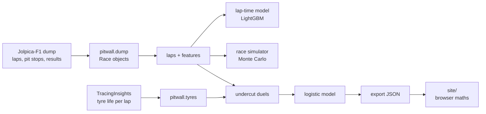

# pitwall

**Will the undercut work?** You are close behind a rival in a Formula 1 race. You pit first, for fresh tyres.
pitwall gives the probability that you come out ahead when the rival pits too.

**Live:** <https://shlokkvaishnav.github.io/pitwall/> — the model runs in your browser.

[](https://shlokkvaishnav.github.io/pitwall/)

## What it does
- **Undercut model.** A logistic regression on three numbers that a strategist knows when the car pits:
  the gap to the car ahead, the tyre-age difference and the laps to go. It learned from 1,190 real pit duels (2018 to 2026).
- **Lap-time model.** A gradient-boosting model (LightGBM) that predicts the next lap time of each car.
- **Race simulator.** A Monte Carlo model that plays each race 2,000 times and gives a probability for each finishing position.
- **A web page with no server.** The model is exported to JSON. The page computes the probability, a map and a sensitivity chart in JavaScript.

## What works and what does not
The 2026 races from 1 September were locked until the end. The final models ran on them once (6 races, [spec 11](specs/11-holdout.md)).

| Part | Development (2018 to Aug 2026) | Locked races (Sep to Oct 2026) |
|---|---|---|
| Lap-time model | 11.5% lower error than "next lap = last lap" | **Holds up.** 17% lower error, better in all 6 races (5,354 laps). |
| Undercut model | Brier skill 0.22 on 2024 and 2025 | **Not confirmed.** Only 20 undercut attempts in these races, and the model did no better than the base rate. Too few to judge. |
| Race simulator | Does not beat the starting grid | Orders the field better than the grid, but its podium odds are worse. |
| Battery use from lap times | Not visible: lap times are too coarse | Not tested |

Each experiment has a written plan with pass/fail rules before the run, in [`specs/`](specs/). Failed tests stay in.
The undercut probability is learned from attempts that teams chose to make, so it is not advice on whether to pit.

## Architecture


## Engineering
- **One-command rebuild.** `make reproduce` downloads the public data (the dump has a pinned SHA-256), runs every experiment,
  and compares every number with the committed results. `make docker-reproduce` does the same in a clean container.
  The last Docker run rebuilt all 11 result files with no difference.
- **The browser and Python agree.** A Node test checks that the JavaScript model gives the scikit-learn probabilities (difference < 1e-5).
- **Checks on each push:** ruff (lint), mypy (types), pytest, Node tests. CI runs only on push, never on a schedule.
- **No raw data in the repository.** The site shows only model numbers.

## Quick start
```bash
make install        # Python 3.10+, creates .venv
make check          # lint, types, tests
make reproduce      # download the data and rebuild all results (about 30 minutes)
```

## Layout
| Path | Content |
|---|---|
| `src/pitwall/` | Data loaders, lap features, models, simulator, undercut duels |
| `scripts/` | One script per experiment, plus the data download and the site export |
| `specs/` | The plan and the result of each experiment |
| `results/` | The result of each experiment (JSON, with the git commit) |
| `site/` | The web page (HTML, CSS, JavaScript, no framework) |

## Data and credits
- [Jolpica-F1](https://github.com/jolpica/jolpica-f1) database dump (non-commercial use).
- [TracingInsights](https://github.com/TracingInsights) open data, MIT and Apache-2.0.
- Related work: a July 2026 preprint with a similar undercut model, [arXiv 2607.06495](https://arxiv.org/abs/2607.06495).
  [Spec 10](specs/10-undercut-open-events.md) compares the two models directly.
- Fonts: Literata and Instrument Sans (SIL Open Font License), in `site/assets/licenses/`.
